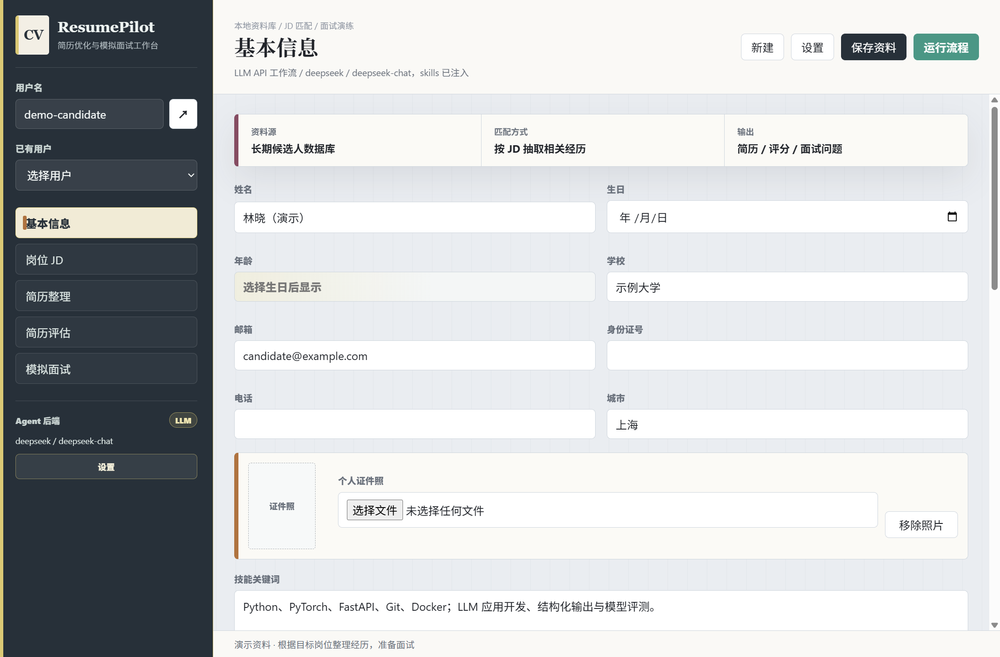
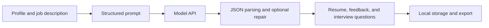

# ResumePilot

**Turn your experience into a tailored resume and a focused interview plan.**

[中文](README.md) · [Quick start](#quick-start) · [Roadmap](#roadmap)

ResumePilot is a Windows desktop workspace for maintaining candidate profiles, tailoring resumes to job descriptions, receiving model-generated feedback, and preparing for interviews. It supports Markdown and PDF export.

Maintained by [xieffffffeng](https://github.com/xieffffffeng), ResumePilot brings profile organization, job matching, and interview preparation into one desktop workflow.

## Preview



*The screenshot uses fictional candidate data.*

## Current features

- Local candidate profiles covering education, work, projects, papers, and skills.
- Chinese resume generation from a manually entered job description.
- Model-generated match scores, keyword feedback, and revision suggestions.
- Interview questions with expandable reference answers and preparation tips.
- DeepSeek, OpenAI, OpenRouter, Ollama, and LM Studio configuration.
- Markdown and PDF resume exports, plus interview question exports.

The current release is desktop prototype v0.1.0. The features above are available; roadmap items below describe future work.

## Quick start

Use Node.js 22.12+ or 24 LTS, npm, and Git. Windows is the primary target.

```powershell
git clone https://github.com/xieffffffeng/ResumePilot.git
cd ResumePilot
npm.cmd ci
npm.cmd start
```

After installing dependencies, Windows users can also double-click `启动应用.cmd`. It clears `ELECTRON_RUN_AS_NODE` before starting Electron.

1. Open Settings, select a model service, and configure its model ID, Base URL, and API key if needed.
2. Save the settings and test the connection. When changing providers, verify both the model and Base URL: existing values may be retained.
3. Create and save a candidate profile.
4. Paste a job description and run the workflow.
5. Review generated facts and numbers, then export the results.

For DeepSeek, the default endpoint is `https://api.deepseek.com/v1` and the model is `deepseek-chat`. Ollama defaults to `http://localhost:11434`; LM Studio defaults to `http://localhost:1234/v1`. Local model services must be started separately.

Profiles are currently entered through forms. Automatic Word/PDF parsing is planned. Match scores are model-generated feedback, not hiring probabilities or objective capability measurements.

## How it works



The current workflow normally uses one main model request to simulate a resume writer, evaluator, and interviewer. Invalid JSON triggers one repair request. If repair fails, the application reports an error. Separate autonomous agents, tool-execution loops, and iterative content verification are not implemented.

Optional Skill injection reads excerpts from configured local documents into the prompt. It can be disabled when those documents are not installed.

## Architecture

| Component | Implementation |
| --- | --- |
| Desktop | Electron |
| UI | HTML, CSS, and JavaScript |
| UI bridge | Preload script and Electron IPC |
| Model calls | Node.js `fetch`, OpenAI-compatible or Ollama endpoints |
| Persistence | Local JSON files and generated artifacts |
| PDF export | HTML template and Electron `printToPDF` |
| Tests | Built-in Node.js test runner |

The main entry point is `main.js`; UI files are in `src/renderer/`, business helpers in `src/services/`, and tests in `tests/`.

## Test and build

```powershell
npm.cmd test
npm.cmd run pack
npm.cmd run dist
```

Build outputs are written to `dist/`. `npm.cmd run dist:cn` uses the configured download mirror for Windows packaging dependencies.

## Data handling

Profiles, settings, and outputs are stored under `%APPDATA%/resumepilot-agent/ResumePilotData/`. API keys are stored in the local settings file; OS credential-store encryption is not currently implemented.

Generation sends profile text, the job description, and enabled Skill excerpts to the configured model provider. Profile photo data is removed before prompt construction. Local storage does not imply local inference when a cloud provider is selected.

Runtime data, credentials, generated resumes, dependencies, and build outputs are excluded from Git. Documentation uses fictional demonstration data.

## Roadmap

- [ ] Word/PDF resume parsing with user-reviewed extraction.
- [ ] Fact provenance, version history, and checks for dates and metrics.
- [ ] Separate generation and review stages with bounded revision rounds.
- [ ] Interactive interview follow-ups based on candidate answers.
- [ ] Fixed evaluation tasks for factual consistency, job coverage, latency, and cost.

These are planned capabilities, not completed features or measured results.

## Project information

Maintainer: [xieffffffeng](https://github.com/xieffffffeng).

Please use [Issues](https://github.com/xieffffffeng/ResumePilot/issues) for reproducible problems or feature requests, using fictional or redacted examples.
