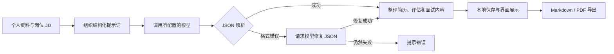

<div align="center">

# ResumePilot

**把个人经历整理成面向岗位的简历，让面试准备更有依据。**

简历生成 · 岗位匹配反馈 · 模拟面试 · 本地资料管理


[快速开始](#快速开始) · [工作流程](#工作流程) · [开发计划](#开发计划) · [English](README.en.md)

</div>

ResumePilot 是一个面向求职场景的桌面助手：维护个人经历资料，粘贴目标岗位 JD，调用大模型生成定制简历、匹配反馈和面试问题，并导出 Markdown 或 PDF。

## 界面预览


*截图中的候选人信息为虚构演示资料。*

## 已有功能

| 功能 | 当前能力 |
| --- | --- |
| 个人资料管理 | 按用户名保存教育、工作、项目、论文和技能资料，支持照片 |
| 面向岗位生成简历 | 根据手动输入的 JD 组织相关经历，生成中文 Markdown 简历 |
| 匹配反馈 | 返回模型给出的参考评分、关键词覆盖和改进建议 |
| 模拟面试准备 | 生成面试问题、可展开的参考答案及答题提示 |
| 多模型配置 | 支持 DeepSeek、OpenAI、OpenRouter、Ollama 和 LM Studio |
| 文件导出 | 导出简历 Markdown、PDF，以及面试问题与答案 |

当前版本为桌面原型 v0.1.0，已支持上述基本流程。文末开发计划记录后续迭代方向。

## 快速开始

### 1. 安装与启动

建议使用 **Node.js 22.12+ 或 24 LTS**、npm 和 Git。当前优先验证 Windows 桌面环境。

```powershell
git clone https://github.com/xieffffffeng/ResumePilot.git
cd ResumePilot
npm.cmd ci
npm.cmd start
```

依赖安装完成后，Windows 用户也可以双击仓库根目录的 **启动应用.cmd**。该脚本会清除可能影响 Electron 启动的 `ELECTRON_RUN_AS_NODE` 环境变量。

### 2. 配置模型

在应用的 **设置** 中选择服务，填写模型名、Base URL 和所需 API Key，保存后点击“测试连接”。

| 服务 | Base URL 示例 | 模型名示例 |
| --- | --- | --- |
| DeepSeek | `https://api.deepseek.com/v1` | `deepseek-chat` |
| OpenAI | `https://api.openai.com/v1` | 填写账号可用的模型 |
| OpenRouter | `https://openrouter.ai/api/v1` | 填写服务端支持的模型 ID |
| Ollama | `http://localhost:11434` | 填写本机已安装的模型 |
| LM Studio | `http://localhost:1234/v1` | 填写本地服务加载的模型 ID |

切换服务后请同时核对模型名与 Base URL；当前界面可能保留上一次填写的值。使用本地模型前，需要先启动对应服务。

### 3. 生成并导出

1. 创建用户名，填写并保存个人资料。
2. 在“岗位 JD”页面填写目标岗位和招聘要求。
3. 点击“运行流程”，查看简历、匹配反馈和面试问题。
4. 核对生成内容中的事实、时间与数字后，导出所需文件。

当前资料主要通过表单维护；自动解析 Word / PDF 简历属于后续计划。模型评分用于辅助修改，不是招聘通过率或客观能力评级。

## 工作流程



当前实现通常通过一次主要模型请求，要求模型按“简历整理、评估、面试官”三个角色输出结构化结果。JSON 解析失败时，再尝试一次格式修复；修复仍失败则提示错误。它尚未实现独立多 Agent 调度、工具自主执行或反复审核修改的闭环。

可选的 Skill 注入会读取配置路径下的文档摘要并加入提示词。未安装相应文档时可关闭该选项，不影响基础流程。

## 技术结构

| 层次 | 实现 |
| --- | --- |
| 桌面与界面 | Electron + 原生 HTML / CSS / JavaScript |
| 页面通信 | `preload` 桥接 + Electron IPC |
| 模型请求 | Node.js `fetch`，OpenAI 兼容接口或 Ollama 接口 |
| 资料存储 | 本地 JSON 文件，按用户名组织 |
| PDF 导出 | HTML 排版 + Electron `printToPDF` |
| 测试 | Node.js 内置测试运行器 |

```text
ResumePilot/
├── main.js                  # 窗口、模型请求与 IPC 入口
├── preload.js               # 向页面提供受控接口
├── src/
│   ├── renderer/            # 页面、样式与交互
│   └── services/
│       ├── llm-workflow.js  # 提示词、JSON 解析与结果规范化
│       ├── storage.js       # 资料和产物存储
│       ├── resume-pdf.js    # PDF HTML 模板
│       └── agents.js        # 资料结构及规则辅助函数
├── tests/                   # 单元测试
├── docs/assets/             # 界面预览
└── 启动应用.cmd             # Windows 便捷入口
```

## 测试与构建

```powershell
npm.cmd test
npm.cmd run pack
npm.cmd run dist
```

`pack` 生成应用目录，`dist` 构建 Windows 便携版本，输出到 `dist/`。如需使用配置好的国内构建下载镜像，可以运行 `npm.cmd run dist:cn`。

## 数据与模型服务

本地资料和设置保存在：

```text
%APPDATA%/resumepilot-agent/ResumePilotData/
├── settings.json
└── users/<username>/
    ├── profile.json
    └── artifacts/
```

API Key 存储于本地设置文件中，当前未采用系统凭据库加密。

运行生成流程时，个人资料文本、JD 和启用的 Skill 摘要会发送至所配置的模型服务；当前工作流不发送证件照图片。选择本地模型与云端模型会改变数据处理位置。

`.gitignore` 已排除运行数据、API 配置、生成文件、依赖和安装包。本仓库只包含源码及虚构演示资料。

## 开发计划

- [ ] 自动解析 Word / PDF 简历，并允许用户确认提取结果。
- [ ] 建立事实来源和版本记录，校验经历、时间与量化指标。
- [ ] 拆分生成与审核步骤，支持基于问题清单的有限轮次修改。
- [ ] 根据用户回答连续追问，记录薄弱点并生成复习建议。
- [ ] 构建固定评测集，对比事实一致性、岗位覆盖、耗时和成本。

这些条目是计划，不代表当前已实现的功能或已有评测结果。

## 项目维护

维护者：[xieffffffeng](https://github.com/xieffffffeng)。

欢迎通过 [Issues](https://github.com/xieffffffeng/ResumePilot/issues) 提交复现步骤、功能建议或失败案例；提交示例时请使用虚构或脱敏资料。
